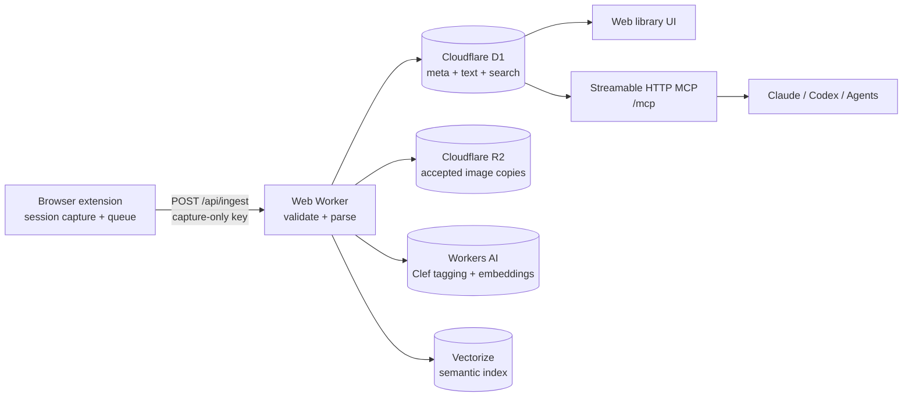

<div align="center">

# 🕸️ Anansi

**Open-source, self-hosted web memory you control, for people and AI agents.**

Anansi captures X bookmarks, Reddit saves, GitHub stars, TikTok favorites, and web pages or Chrome bookmarks from the browser sessions you already use, stores them in a searchable library you control, and lets compatible AI agents search and retrieve those saved references through nine read tools and four optional write tools. It is free and MIT-licensed.

[](./LICENSE)
[](https://modelcontextprotocol.io)
[](https://github.com/jojomensah89/anansi)
[](https://github.com/jojomensah89/anansi)
[](https://github.com/jojomensah89/anansi/issues)
[](https://github.com/jojomensah89/anansi/commits)
[](https://github.com/jojomensah89/anansi/actions/workflows/ci.yml)

[](https://deploy.workers.cloudflare.com/?url=https%3A%2F%2Fgithub.com%2Fjojomensah89%2Fanansi)

[Website](https://anansi.jojomensah.com) · [Get Started](#-quickstart) · [Supported Sources](#-supported-sources) · [Ask it from your agent](#-ask-it-from-your-agent-mcp) · [Report a bug](https://github.com/jojomensah89/anansi/issues/new?template=bug_report.yml)


</div>

## ✨ What Anansi does

Anansi does the following:

- 📥 **Captures supported saves** — X bookmarks, Reddit saves, GitHub stars, TikTok favorites, and Web pages
- 🔖 **Mirrors Chrome bookmarks** — optional Chrome bookmark capture is stored as Web items
- 🔍 **Searches the library** — saved text, authors, sources, tags, and recency
- 💾 **Keeps the library under your control** — self-host on your own Cloudflare account; local operation is for development and testing
- 🗂️ **Organizes with shelves and topics** — shelves hold hand-picked saves, a filter rule, or both; optional AI tagging assigns topics you can edit
- 🧠 **Exposes saved references to agents** — nine read tools and four optional write tools search, retrieve, list, and summarize the library
- 🔑 **Signs in with passkeys** — add passkeys in Settings; `ANANSI_SECRET` stays as the recovery key
- 📤 **Exports your data** — one JSON file, restorable into an empty library
- 🔁 **Recovers from interruptions** — queued capture, retry, and resumable imports survive restarts and rate limits
- 🔒 **Uses bounded access** — explicit capture, bearer-auth ingest, no `<all_urls>`, no `cookies` permission, and no GitHub OAuth or PAT

## 📥 Supported Sources

| Source | Capture | Status |
| --- | --- | --- |
|  X bookmarks | History import + live saves | Supported |
|  Reddit saves | History import + live saves | Supported |
|  GitHub stars | Full import + live star/unstar events | Supported |
|  Web pages & bookmarks | Save pages, selections, and Chrome bookmarks | Supported |
|  Chrome bookmarks (web submode) | Optional mirroring into Web pages & bookmarks | Supported |
|  TikTok favorites | Signed-in browser import | Browser capture restored; authenticated acceptance pending |

GitHub and Reddit imports use the signed-in browser session without opening tabs. X uses a page tab; TikTok scrolls Favorites in a focused window. TikTok is opt-in and does not store video files. The popup has separate source switches for X, Reddit, GitHub and TikTok, plus optional Chrome bookmark mirroring. Disabling a source does not delete its history.

Opening the library requests on-demand sync; the extension checks the owner's server every two minutes for requests from other devices. Recent checks are skipped for five minutes unless Sync now is used. There is no daily platform catch-up timer. Public GitHub stars can also be checked by the Worker after the owner enters a username. Private stars need the browser. Browser sync needs a running desktop browser and signed-in provider sessions. Bounded catch-up may require a full import after a large gap.

Code supports these five sources; signed-in side-by-side acceptance remains pending. See [owner test](release/side-by-side-test.md).

## 🚀 Quickstart

Host your library in your own Cloudflare account. The local path below is for development and testing.

### A. Local development

Requirements: [Bun](https://bun.sh/) 1.4.2+ and a Chromium browser (Chrome, Brave, Edge or Arc). The local Worker uses emulated D1/R2; `bun run dev` builds the app, applies local SQL migrations and starts the compiled Worker.

```bash
bun install
cp .env.example .env
# Edit .env and set your master secret:
#   ANANSI_SECRET=your-random-secret
bun run dev
```

Open `http://127.0.0.1:8787`. This is the one public local origin: the library is at `/`, JSON endpoints are under `/api`, and MCP is at `/mcp`.

`bun dev` first applies the SQL migrations, then starts Vite with the Cloudflare and TanStack plugins. Local D1 and R2 use `.wrangler/state` at the repository root. This Worker development path does not read the older `data/anansi.db` SQLite library. To apply local migrations separately, run `bun run db:migrate:local`.

Use `.env` for this local setup. If `.dev.vars` exists, Wrangler uses it instead of `.env`; keep its secret aligned or remove that duplicate secrets file.

Build the extension. It is free and MIT-licensed. It is not on the Chrome Web Store yet, so for now you build it with Bun and load it unpacked. A store version is coming and will be free too.

```bash
bun run --cwd apps/extension build
```

Open your browser's extensions page (`chrome://extensions`, `brave://extensions` or `edge://extensions`) → enable **Developer mode** → **Load unpacked** → choose `apps/extension/.output/public/chrome-mv3`. Click the Anansi icon, enter your local Worker URL (`http://127.0.0.1:8787` or hosted URL) and `INGEST_TOKEN` if configured (otherwise `ANANSI_SECRET`), and click **Connect**. Public builds contain no deployment credentials. Configured owner-only builds require the explicit `build:private` command; never distribute them.

GitHub first import: sign in to GitHub in the same browser profile → popup → **Import** beside GitHub. It walks your stars pages in the worker (no tabs open), persists the pagination cursor, and resumes after interruptions. Unstarring hides from current-star view without deleting history; re-starring restores it.

TikTok favorites: sign in to TikTok in the same browser and press **Import** in the extension's TikTok row. Anansi opens a focused window and scrolls the rendered Favorites list. The live path is enabled in this build but still needs an authenticated browser acceptance check. It keeps Favorites separate from Likes and does not store video files.

Library data backup: open **Settings → Data** and use **Export library** (one JSON file, no media files). On a new, empty Anansi installation, use **Restore from an export** in the same section and choose that file. Restore validates the file before starting and uploads records in resumable batches; choose the same file after an interruption. It restores item and collection data, shelf contents, AI topics, tags and manual tag decisions, highlights, media metadata, and Chrome bookmark links. It does not contain R2 or local media bytes; those must be fetched again where their origin is still available. A permanently rejected chunk after partial progress requires a fresh empty installation for recovery. Browser restore accepts files up to 100 MB.

### AI Tagging & Semantic Search

Anansi leverages Cloudflare Workers AI and Vectorize:

- **Automatic Tagging**: Powered by `@cf/cloudflare/clef-flash` to assign concise, consistent topic tags to saves as they are captured.
- **Semantic Search**: Powered by `@cf/baai/bge-small-en-v1.5` and Cloudflare Vectorize to find items by concept and meaning alongside BM25 keyword search.
- Both features are off by default. Turn either on or off in **Settings → AI** (`/settings/ai`), where the topic list is also editable.

### B. Cloudflare — one-click self-hosting

Use the **Deploy to Cloudflare** button at the top of this README. Cloudflare
copies this public GitHub repository into your account, provisions the Worker
resources declared in [`wrangler.jsonc`](./wrangler.jsonc), and builds and
deploys the app with Workers Builds. Future pushes to the connected repository
can trigger builds and deployments. Cloudflare requires the source repository
to be public for this button flow.

The root build targets the web Worker; the browser extension remains a separate
local build. Keep the project root at the repository root because the Worker
build uses shared Bun workspace packages. See Cloudflare's [Deploy to Cloudflare
button documentation](https://developers.cloudflare.com/workers/platform/deploy-buttons/)
for the button flow and its repository requirements. D1 migration files in
`packages/db/drizzle` are the canonical schema history. Never use `db:push`:
the FTS5 virtual table and triggers require the SQL migration path.

The hosted library uses new D1 and R2 resources in your Cloudflare account.
Deploying does not copy an existing local `data/anansi.db` or `data/media`
directory; the first hosted library starts empty. Keep the local copy as a
backup if you need those captures, because this deployment path does not
include a local-to-cloud import.

In the deploy form, keep the repository root and default resource names. Enter
`ANANSI_SECRET` (generate with `openssl rand -hex 32`), Vectorize dimensions
**384**, and metric **cosine**. Wrangler cannot encode these two index creation
settings. These are the Anansi-specific inputs beyond the standard account and
repository choices. D1 and R2 are provisioned automatically. Both AI features
start off; missing AI bindings leave capture, keyword search, export and restore
available.

#### Hosted semantic search

Hosted semantic search is off until you enable it in Settings. Before the first
backfill, Anansi shows the number of saved items and chunks and asks you to
confirm. Captures continue while indexing runs in the background. You can pause
indexing without removing the vectors already in use, or turn semantic search
off to remove hosted chunk text from D1 and queue its Vectorize vectors for
retryable deletion.

Long captures are split at paragraph and sentence boundaries into chunks of up
to 1,800 characters, with 180 characters of overlap. D1 stores the normalized
title/capture-text chunks, offsets, hashes, and model/chunker generation;
Vectorize stores the corresponding vectors under stable IDs. Search combines
keyword and vector candidates, applies the same library filters, collapses
chunk matches to one saved item, and shows the best-matching chunk excerpt.
MCP uses the same hybrid search coordinator, with keyword fallback when AI is off, unavailable or at its cap.

Hosted indexing and query embeddings share a per-library monthly cap of 10,000
app credits by default. One credit counts each started 1,000 characters sent in
an embedding input. Credits track workload; they are not a provider-bill estimate.
At the cap, Anansi sends no more embedding requests; captures still save, and
search requests that cannot be embedded fall back to keyword results. You can
change the cap in Settings.

Workers Builds honors the root `packageManager: bun@1.4.2`; no manual
`BUN_VERSION` is needed. Accept the detected `bun run build` and `bun run deploy`
commands. Deploy applies pending D1 SQL migrations before publishing.
See [fresh-account acceptance](docs/deploy-acceptance.md) for the timed checklist.

After deployment returns `https://<worker>.workers.dev`:

1. Open the URL and sign in with `ANANSI_SECRET`. Then add a passkey in **Settings → Security**. Passkeys need a hostname, so use `localhost` rather than `127.0.0.1` for local development.
2. Build and load the extension unpacked as described above, then click the Anansi icon in the toolbar.
3. In the signed-in library, use **Connect extension**, grant the exact origin in the popup and paste the single-use code. Pasting a capture key remains a fallback.
4. Sign into each provider (X, GitHub, Reddit, TikTok) in the same Chrome profile before its first import.
5. Open the MCP setup page to connect an OAuth app or create a named API key.

The Worker is the only public origin: the library is `/`, the API is `/api/*`,
and MCP is `/mcp`. New schema changes start with `packages/db/src/schema.ts`
and hand-written SQL migrations in `packages/db/drizzle` with corresponding
`meta/_journal.json` entries; review the new migration, then push
to the connected repository. Workers Builds applies pending D1 migrations
before publishing the Worker.

#### Manual deploy and local development

For a manual deployment, configure the resources and secrets in your Cloudflare account, then run:

```powershell
bun run cf-typegen
bun run build
bun run deploy
```

`bun run deploy` applies remote D1 migrations and publishes the Worker output created by `bun run build`.
Local development runs through `bun run dev` (Vite with the Cloudflare plugin, local D1 migrations, and a fixed `http://127.0.0.1:8787` origin).

## 🧠 Ask it from your agent (MCP)

Streamable HTTP MCP is at your deployment's `/mcp`. Use OAuth sign-in for compatible apps, or a named, revocable API key for CLI tools and scripts. Connected clients are read-only by default. The owner can grant write access in Connected clients; revocation and permission changes apply on the next request. Legacy shared credentials are migration-only and can be retired.

| Tool | Purpose |
| --- | --- |
| `search_saved` | Search saved items, ranked excerpts + source URLs |
| `get_saved` | One item with text, links, media, thread context |
| `get_saved_many` | A bounded shortlist of items in requested order |
| `list_saved` | Browse saved items with filters and a cursor |
| `list_recent_saves` | Newest saved items |
| `list_author_saves` | Items from one author |
| `list_tags` | Visible tag vocabulary and usage counts |
| `library_stats` | Visible library and media statistics |
| `list_shelves` | The owner's shelves with save counts; pass a shelf id to `list_saved` or `search_saved` |

The optional `source` filter accepts visible `x`, `reddit`, `github`, `web`, and `tiktok` items.

Write-enabled clients also receive `add_tag`, `remove_tag`, `set_note` and `save_link`: 13 tools total, nine for read-only clients. No delete tool exists. Agent searches request Reddit/GitHub sync by default; X/TikTok require the separate owner opt-in.

### Connecting your agent

**Claude Code**:

```bash
claude mcp add --transport http anansi http://127.0.0.1:8787/mcp --header "Authorization: Bearer <YOUR_NAMED_API_KEY>"
```

**Cursor / Windsurf / Codex (HTTP MCP)**:

```json
{
  "mcpServers": {
    "anansi": {
      "url": "http://127.0.0.1:8787/mcp",
      "headers": {
        "Authorization": "Bearer <YOUR_NAMED_API_KEY>"
      }
    }
  }
}
```

## 🏗️ How it works



Durable boundaries: extension captures and queues; worker validates and parses; database owns identity, search, removal state, and provenance; MCP and HTTP call the same database functions.

<details>
<summary><strong>Project structure & API</strong></summary>

```text
apps/extension/    WXT React MV3 extension and platform content scripts
apps/web/          TanStack Start UI, JSON API, Streamable HTTP MCP route, Worker entrypoint
packages/db/       D1/SQLite schema, migrations, search, and item operations
packages/mcp/      Transport-independent MCP server and tool definitions
packages/sources/  Shared capture contracts and source parsers
packages/ui/       Shared UI components and styles
packages/env/      Typed runtime environment bindings
wrangler.jsonc    Cloudflare Worker bindings and deployment configuration
```

```text
GET  /api/stats   GET /api/items   GET /api/items/:id   GET /api/search?q=...
GET  /api/recent  GET /api/authors?handle=...           GET /api/creators
GET  /api/sources GET/PATCH /api/ai POST /api/ingest POST /api/extension/heartbeat
GET  /api/extension/config
GET/POST /api/shelves   GET /api/tags   GET /api/export   POST /api/restore/*
```

`POST /api/ingest` and heartbeat accept per-browser capture keys; shared credentials remain only until legacy access is retired. Ingest is closed when no secret is configured.

</details>

## 🔒 Privacy by design

- No `<all_urls>` permission · No `cookies` permission · No GitHub OAuth / PAT for extension capture
- GitHub + Reddit use browser-managed session cookies; X uses signed-in page scripts. Cookie values are never read or uploaded.
- Raw payloads are bounded and validated before server-side parsing; extension traffic is bearer-authed
- Chrome bookmark access is optional, requested only when mirroring is enabled
- D1 + R2 in your Cloudflare account. Never commit secrets, database files, raw captures, or media.

## 🛠️ Development

[](https://bun.sh)
[](./package.json)
[](./wrangler.jsonc)

```bash
bun test
bun run typecheck
bun run --cwd apps/extension build
bun run build
```

Covers queue recovery, retries, parser fixtures, authenticated ingest, GitHub import/live transitions, search, source health, and card rendering. See [CONTRIBUTING.md](./CONTRIBUTING.md) — scrub fixtures before committing.

## 🗺️ Roadmap

- [ ] 🔍 Cloudflare AI-enrichment acceptance — Workers AI Clef tagging and Vectorize semantic search clean-account acceptance
- [ ] First clean-account deploy: install → migrate → first capture → search → export → restore against Cloudflare
- [ ] Measured free-tier usage + media-host allowlist published here
- [ ] Synthetic demo library
- [ ] Pinterest capture — add a browser-session importer and live-save path
- [ ] TikTok live favorites — complete authenticated browser acceptance for import and native bookmark events

Have an idea? [Open a feature request](https://github.com/jojomensah89/anansi/issues/new?template=feature_request.yml).

## 🤝 Contributing

PRs welcome — small and focused wins. Read [CONTRIBUTING.md](./CONTRIBUTING.md), follow the privacy rules, run the checks above. Report vulnerabilities privately per [SECURITY.md](./SECURITY.md). Be kind per [CODE_OF_CONDUCT.md](./CODE_OF_CONDUCT.md).

Useful early contributions include clearer setup docs, scrubbed source fixtures, parser and import fixes, MCP client examples, accessibility improvements, and focused library UX changes. If you are unsure where to begin, open a small issue describing the user problem before starting a large change.

## 💛 Support

Anansi is free, including the extension. If it is useful to you, you can pay what you want through [Polar](https://buy.polar.sh/polar_cl_23HStXNgQMfXFavpX5s33s4PzRtZuNxJU1WWl0cIfgF), or star the repository. Both are optional.

## 📄 License

MIT © 2026 Jojo Mensah — see [LICENSE](./LICENSE). The Anansi name and logo are trademarks and are not covered by the MIT licence.

---

Built by Jojo Mensah · Follow along for demos and changelogs

<a href="https://buy.polar.sh/polar_cl_23HStXNgQMfXFavpX5s33s4PzRtZuNxJU1WWl0cIfgF">Support Anansi</a> · <a href="https://x.com/jojomensah89"></a>
