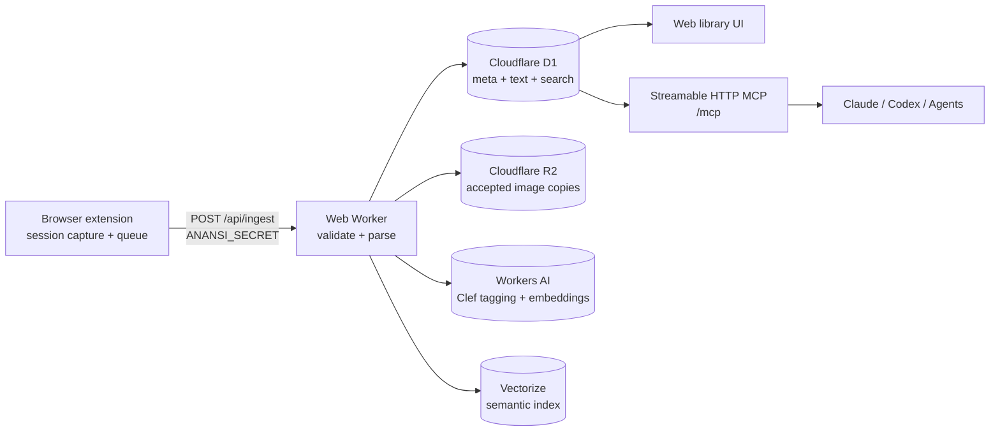

<div align="center">

# 🕸️ Anansi

**Open-source, local-first web memory you control, for people and AI agents.**

Anansi captures X bookmarks, Reddit saves, GitHub stars, and web pages or Chrome bookmarks from the browser sessions you already use, stores them in a searchable library you control, and lets compatible AI agents search and retrieve those saved references through eight read-focused MCP tools.

[](./LICENSE)
[](https://modelcontextprotocol.io)
[](https://github.com/jojomensah89/anansi)
[](https://github.com/jojomensah89/anansi)
[](https://github.com/jojomensah89/anansi/issues)
[](https://github.com/jojomensah89/anansi/commits)
[](https://github.com/jojomensah89/anansi/actions/workflows/ci.yml)

[](https://deploy.workers.cloudflare.com/?url=https%3A%2F%2Fgithub.com%2Fjojomensah89%2Fanansi)

[Follow the build](https://github.com/jojomensah89/anansi) · [Get Started](#-quickstart) · [Supported Sources](#-supported-sources) · [Ask it from your agent](#-ask-it-from-your-agent-mcp) · [Report a bug](https://github.com/jojomensah89/anansi/issues/new?template=bug_report.yml)


</div>

## ✨ What Anansi does

Anansi does the following:

- 📥 **Captures supported saves** — X bookmarks, Reddit saves, GitHub stars, and Web pages
- 🔖 **Mirrors Chrome bookmarks** — optional Chrome bookmark capture is stored as Web items
- 🔍 **Searches the library** — saved text, authors, sources, tags, and recency
- 💾 **Keeps the library under your control** — run locally with SQLite or use the repository's own-account Cloudflare deployment path
- 🧠 **Exposes saved references to agents** — eight read-focused MCP tools search, retrieve, list, and summarize the library
- 🔁 **Recovers from interruptions** — queued capture, retry, and resumable imports survive restarts and rate limits
- 🔒 **Uses bounded access** — explicit capture, bearer-auth ingest, no `<all_urls>`, no `cookies` permission, and no GitHub OAuth or PAT

## 📥 Supported Sources

| Source | Capture | Status |
| --- | --- | --- |
|  X bookmarks | History import + live saves | Supported |
|  Reddit saves | History import + live saves | Supported |
|  GitHub stars | Full import + live star/unstar events | Supported |
|  Web pages & bookmarks | Save pages, selections, and Chrome bookmarks | Supported |
|  Chrome bookmarks (web submode) | Optional mirroring into Web pages & bookmarks | Supported |
|  TikTok favorites | Signed-in browser import | Browser capture restored; authenticated acceptance pending |

> GitHub capture is extension-only. It reads the signed-in GitHub stars pages in your browser, includes repositories visible to that account — including visible private repositories — and needs no GitHub OAuth or personal access token.

Live saves are delivered immediately for sources with extension capture. Anansi also performs one daily incremental catch-up for sources that support history import, covering changes made while Chrome or the extension was inactive. GitHub and Reddit import via background session requests without opening tabs. Anansi closes only tabs it created. If a provider session is missing, the popup asks you to sign in — use the explicit **Sign in** button, then retry. Network and rate-limit failures keep the resume cursor. TikTok's browser importer observes its signed-in Favorites responses; its authenticated behavior still needs an end-to-end browser check.

## 🚀 Quickstart

Two paths, same library: run it locally or host it in your own Cloudflare account.

### A. Local

Requirements: [Bun](https://bun.sh/) 1.3+, Chromium-based browser. SQLite DB is created automatically.

```bash
bun install
cp .dev.vars.example .dev.vars
# Edit .dev.vars and set your master secret:
#   ANANSI_SECRET=your-random-secret
bun run dev
```

Open `http://127.0.0.1:8787`. This is the one public local origin: the library is at `/`, JSON endpoints are under `/api`, and MCP is at `/mcp`.

Build the extension:

```bash
bun run --cwd apps/extension build
```

Open `chrome://extensions` → enable **Developer mode** → **Load unpacked** → choose `apps/extension/.output/chrome-mv3`. Click the Anansi icon in the toolbar, enter your local Worker URL (`http://127.0.0.1:8787` or hosted URL) and `ANANSI_SECRET`, and click **Connect**. The extension validates the connection and saves your bookmarks seamlessly. (You can also pre-bake secrets in `.env` for private builds).

GitHub first import: sign in to GitHub in the same browser profile → popup → **Import** beside GitHub. It walks your stars pages in the worker (no tabs open), persists the pagination cursor, and resumes after interruptions. Unstarring hides from current-star view without deleting history; re-starring restores it.

TikTok favorites: sign in to TikTok in the same browser and press **Import** in the extension's TikTok row. Anansi opens your profile, selects Favorites, and observes TikTok's own list responses. The live path is enabled in this build but still needs an authenticated browser acceptance check. It keeps Favorites separate from Likes and does not store video files.

Library data backup: use **Saved views → Download library data (no media files)**. On a new, empty Anansi installation, choose **Restore into an empty library** in the same menu and select that JSON file. Restore validates the file before starting and uploads records in resumable batches; choose the same file after an interruption. It restores item and collection data, tags and manual tag decisions, highlights, media metadata, and Chrome bookmark links. It does not contain R2 or local media bytes; those must be fetched again where their origin is still available. A permanently rejected chunk after partial progress requires a fresh empty installation for recovery. Browser restore accepts files up to 100 MB.

### AI Tagging & Semantic Search

Anansi leverages Cloudflare Workers AI and Vectorize:

- **Automatic Tagging**: Powered by `@cf/clef-flash-9b` to assign concise, consistent topic tags to saves as they are captured.
- **Semantic Search**: Powered by `@cf/baai/bge-small-en-v1.5` and Cloudflare Vectorize to find items by concept and meaning alongside BM25 keyword search.
- Both features are optional and can be toggled on/off in **Settings** (`/settings`).

### B. Cloudflare — one-click self-hosting

Use the **Deploy to Cloudflare** button at the top of this README. Cloudflare
copies this public GitHub repository into your account, provisions the Worker
resources declared in [`wrangler.jsonc`](./wrangler.jsonc), and builds and
deploys the app with Workers Builds. Future pushes to the connected repository
can trigger builds and deployments. Cloudflare requires the source repository
to be public for this button flow.

The root build targets the web Worker; the browser extension remains a separate
local build. Keep the project root at the repository root because the Worker
build uses shared Bun workspace packages. See Cloudflare's [Deploy to Cloudflare
button documentation](https://developers.cloudflare.com/workers/platform/deploy-buttons/)
for the button flow and its repository requirements. D1 migration files in
`packages/db/drizzle` are the canonical schema history. Never use `db:push`:
the FTS5 virtual table and triggers require the SQL migration path.

The hosted library uses new D1 and R2 resources in your Cloudflare account.
Deploying does not copy an existing local `data/anansi.db` or `data/media`
directory; the first hosted library starts empty. Keep the local copy as a
backup if you need those captures, because this deployment path does not
include a local-to-cloud import.

In Cloudflare's deploy form, set the Vectorize index to **384 dimensions** and
the **cosine** metric. Anansi's default hosted embedding model,
`@cf/baai/bge-small-en-v1.5`, returns 384-dimensional vectors. The Deploy form
does not infer these fixed index settings from Wrangler, so this is a required
resource-setup value; using a different dimension or metric will break semantic
search. The model and Vectorize index are only used after semantic search is
enabled in Settings.

During setup, enter your master secret when Cloudflare prompts for it:

- `ANANSI_SECRET` — master secret protecting library sign-in, Chrome extension ingestion, and MCP clients. (Legacy `LIBRARY_TOKEN`, `INGEST_TOKEN`, and `MCP_TOKEN` remain supported if configured individually).

Generate with `openssl rand -hex 32`. Both Cloudflare AI features start off; enable
Semantic search or Automatic tags from `/settings` only when you want to use
your account's AI quota.

#### Hosted semantic search

Hosted semantic search is off until you enable it in Settings. Before the first
backfill, Anansi shows the number of saved items and chunks and asks you to
confirm. Captures continue while indexing runs in the background. You can pause
indexing without removing the vectors already in use, or turn semantic search
off to remove hosted chunk text from D1 and queue its Vectorize vectors for
retryable deletion.

Long captures are split at paragraph and sentence boundaries into chunks of up
to 1,800 characters, with 180 characters of overlap. D1 stores the normalized
title/capture-text chunks, offsets, hashes, and model/chunker generation;
Vectorize stores the corresponding vectors under stable IDs. Search combines
keyword and vector candidates, applies the same library filters, collapses
chunk matches to one saved item, and shows the best-matching chunk excerpt.
MCP search remains keyword/BM25.

Hosted indexing and query embeddings share a per-library monthly cap of 10,000
app credits by default. One credit counts each started 1,000 characters sent in
an embedding input. Credits track workload; they are not a provider-bill estimate.
At the cap, Anansi sends no more embedding requests; captures still save, and
search requests that cannot be embedded fall back to keyword results. You can
change the cap in Settings.

After the first successful deploy, open the Worker project’s **Settings → Build
→ Build Variables and Secrets** and add `BUN_VERSION=1.3.1` for subsequent
builds. The first button build uses Cloudflare's default Bun version and must
pass the clean-account acceptance check before this button is announced as
ready.

After deployment returns `https://<worker>.workers.dev`:

1. Open the URL and sign in with `ANANSI_SECRET`.
2. In the Chrome extension (either from the Chrome Web Store or unpacked build), click the Anansi icon in the toolbar.
3. Enter your deployed Worker URL and `ANANSI_SECRET`, and click **Connect**.
4. Sign into each provider (X, GitHub, Reddit, TikTok) in the same Chrome profile before its first import.
5. Add the Worker URL and `ANANSI_SECRET` to any remote MCP client you want to use (`Authorization: Bearer <ANANSI_SECRET>`).

The Worker is the only public origin: the library is `/`, the API is `/api/*`,
and MCP is `/mcp`. New schema changes start with `packages/db/src/schema.ts`
and `bun run db:generate`; review and commit the new SQL migration, then push
to the connected repository. Workers Builds applies pending D1 migrations
before publishing the Worker.

#### Manual deploy and local development

For a manual deployment, configure the resources and secrets in your Cloudflare account, then run:

```powershell
bun run cf-typegen
bun run build
bun run deploy
```

`bun run deploy` applies remote D1 migrations and publishes the Worker output created by `bun run build`.
Local development runs through `bun run dev` (powered by Wrangler with local D1 emulation).

## 🧠 Ask it from your agent (MCP)

Streamable HTTP MCP server at `http://127.0.0.1:8787/mcp` locally (or `https://<worker>.workers.dev/mcp` when hosted). Bearer auth with `ANANSI_SECRET` (or legacy `MCP_TOKEN`) when configured. The web `/mcp` setup page uses a literal `<YOUR_ANANSI_SECRET>` placeholder and never prints the secret.

| Tool | Purpose |
| --- | --- |
| `search_saved` | Search saved items, ranked excerpts + source URLs |
| `get_saved` | One item with text, links, media, thread context |
| `get_saved_many` | A bounded shortlist of items in requested order |
| `list_saved` | Browse saved items with filters and a cursor |
| `list_recent_saves` | Newest saved items |
| `list_author_saves` | Items from one author |
| `list_tags` | Visible tag vocabulary and usage counts |
| `library_stats` | Visible library and media statistics |

The optional `source` filter accepts visible `x`, `reddit`, `github`, `web`, and `tiktok` items.

### Connecting your agent

**Claude Code**:

```bash
claude mcp add --transport http anansi http://127.0.0.1:8787/mcp --header "Authorization: Bearer <YOUR_ANANSI_SECRET>"
```

**Cursor / Windsurf / Codex (HTTP MCP)**:

```json
{
  "mcpServers": {
    "anansi": {
      "url": "http://127.0.0.1:8787/mcp",
      "headers": {
        "Authorization": "Bearer <YOUR_ANANSI_SECRET>"
      }
    }
  }
}
```

## 🏗️ How it works



Durable boundaries: extension captures and queues; worker validates and parses; database owns identity, search, removal state, and provenance; MCP and HTTP call the same database functions.

<details>
<summary><strong>Project structure & API</strong></summary>

```text
apps/extension/    WXT React MV3 extension and platform content scripts
apps/web/          TanStack Start UI, JSON API, Streamable HTTP MCP route, Worker entrypoint
packages/db/       D1/SQLite schema, migrations, search, and item operations
packages/mcp/      Transport-independent MCP server and tool definitions
packages/sources/  Shared capture contracts and source parsers
packages/ui/       Shared UI components and styles
packages/env/      Typed runtime environment bindings
wrangler.jsonc    Cloudflare Worker bindings and deployment configuration
```

```text
GET  /api/stats   GET /api/items   GET /api/items/:id   GET /api/search?q=...
GET  /api/recent  GET /api/authors?handle=...           GET /api/creators
GET  /api/sources GET/PATCH /api/ai POST /api/ingest POST /api/extension/heartbeat
GET  /api/extension/config
```

`POST /api/ingest` and heartbeat require `ANANSI_SECRET` (or `INGEST_TOKEN`). Ingest is closed when no secret is configured.

</details>

## 🔒 Privacy by design

- No `<all_urls>` permission · No `cookies` permission · No GitHub OAuth / PAT for extension capture
- GitHub + Reddit use browser-managed session cookies; X uses signed-in page scripts. Cookie values are never read or uploaded.
- Raw payloads are bounded and validated before server-side parsing; extension traffic is bearer-authed
- Chrome bookmark access is optional, requested only when mirroring is enabled
- D1 + R2 in your Cloudflare account. Never commit secrets, database files, raw captures, or media.

## 🛠️ Development

[](https://bun.sh)
[](./package.json)
[](./wrangler.jsonc)

```bash
bun test
bun run typecheck
bun run --cwd apps/extension build
bun run build
```

Covers queue recovery, retries, parser fixtures, authenticated ingest, GitHub import/live transitions, search, source health, and card rendering. See [CONTRIBUTING.md](./CONTRIBUTING.md) — scrub fixtures before committing.

## 🗺️ Roadmap

- [ ] 🔍 Cloudflare AI-enrichment acceptance — Workers AI Clef tagging and Vectorize semantic search clean-account acceptance
- [ ] 🗂️ Collections v2 — curated hand-picked lists alongside today's saved filter views
- [ ] First clean-account deploy: install → migrate → first capture → search → export → restore against Cloudflare
- [ ] Measured free-tier usage + media-host allowlist published here
- [ ] Synthetic demo library
- [ ] Pinterest capture — add a browser-session importer and live-save path
- [ ] TikTok live favorites — complete authenticated browser acceptance for import and native bookmark events

Have an idea? [Open a feature request](https://github.com/jojomensah89/anansi/issues/new?template=feature_request.yml).

## 🤝 Contributing

PRs welcome — small and focused wins. Read [CONTRIBUTING.md](./CONTRIBUTING.md), follow the privacy rules, run the checks above. Report vulnerabilities privately per [SECURITY.md](./SECURITY.md). Be kind per [CODE_OF_CONDUCT.md](./CODE_OF_CONDUCT.md).

Useful early contributions include clearer setup docs, scrubbed source fixtures, parser and import fixes, MCP client examples, accessibility improvements, and focused library UX changes. If you are unsure where to begin, open a small issue describing the user problem before starting a large change.

## 📄 License

MIT © 2026 Jojo Mensah — see [LICENSE](./LICENSE).

---

Built by Jojo Mensah · Follow along for demos and changelogs

<a href="https://buymeacoffee.com/jojomensahh"></a>
<a href="https://x.com/jojomensah89"></a>
